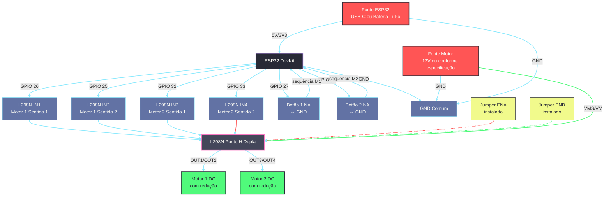
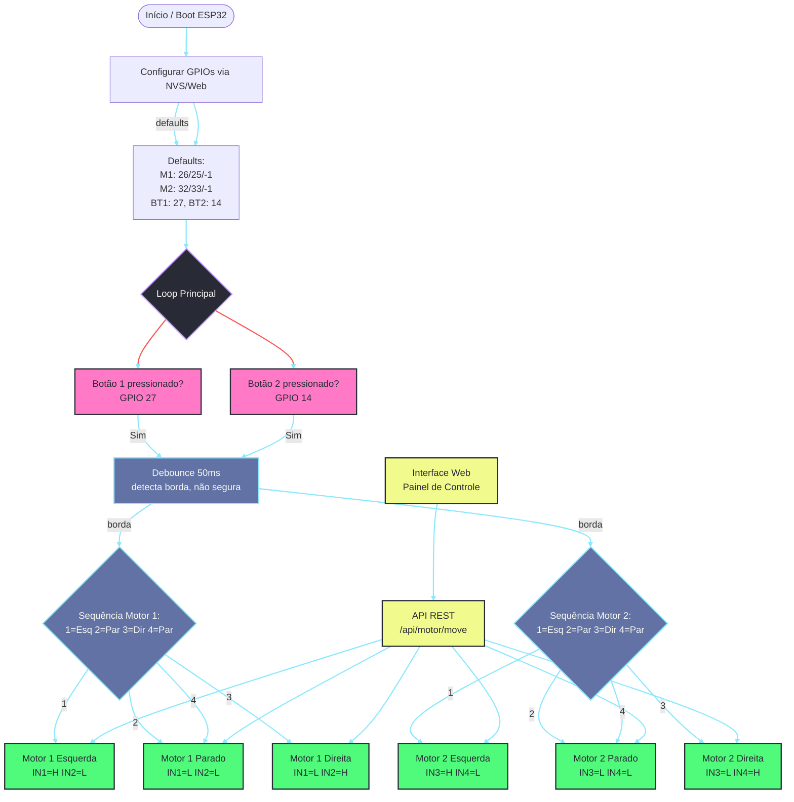

# WindFollowBlind — Documentação Completa da Solução

Projeto: controle de **2 motores DC via driver L298N** + **2 botões NA** em **ESP32 DevKit**, sem câmera. Interface web embarcada (AP + mDNS) e simulador para navegador.

---

## 1. Visão Geral

| Item | Detalhe |
|------|---------|
| Nome | WindFollowBlind |
| Placa | ESP32 DevKit (ou similar com ESP32) |
| Driver | L298N (ponte H dupla) |
| Atuadores | 2 motores DC com redução |
| Entrada | 2 botões normalmente abertos (NA) |
| Rede | AP `WindFollowBlind-Setup` + mDNS `http://windfollowblind.local` |
| Interface | Web embarcada (dashboard, configuração de GPIOs, setup Wi-Fi) |
| Firmware | Arduino ESP32 (core 3.3.10) |
| Simulador | `simulator/windflollowblind/index.html` (navegador, sem ESP32) |

## 1.1 Diagrama de Conexões (Visão Geral)

O diagrama abaixo mostra todas as ligações entre ESP32, L298N, motores, botões e fontes:



## 1.2 Diagrama de Fluxo de Funcionamento (Botões)



---

## 2. Pinagem de Cada Equipamento

### 2.1 ESP32 → L298N (sinais de controle)

| Sinal L298N | GPIO ESP32 | Função | Observação |
|-------------|------------|--------|------------|
| IN1 (Motor 1) | **GPIO 26** | Sentido de rotação 1 do Motor 1 | Saída digital |
| IN2 (Motor 1) | **GPIO 25** | Sentido de rotação 2 do Motor 1 | Saída digital |
| ENA (Motor 1) | **-1** (jumper) | Habilitação / PWM do Motor 1 | Jumper instalado = velocidade máxima |
| IN3 (Motor 2) | **GPIO 32** | Sentido de rotação 1 do Motor 2 | Saída digital |
| IN4 (Motor 2) | **GPIO 33** | Sentido de rotação 2 do Motor 2 | Saída digital |
| ENB (Motor 2) | **-1** (jumper) | Habilitação / PWM do Motor 2 | Jumper instalado = velocidade máxima |

> Se quiser controlar a velocidade por PWM, remova o jumper ENA/ENB e ligue nos GPIOs configurados (padrão está desativado: -1).

### 2.2 L298N → Motores (saídas de potência)

| Canal L298N | Saídas | Motor |
|-------------|--------|-------|
| Canal A | OUT1 e OUT2 | Motor 1 |
| Canal B | OUT3 e OUT4 | Motor 2 |

### 2.3 Botões NA (entradas)

| Botão | GPIO ESP32 | Segundo terminal | Função |
|-------|------------|------------------|--------|
| Botão 1 | **GPIO 27** | GND | Avança sequência do Motor 1 |
| Botão 2 | **GPIO 14** | GND | Avança sequência do Motor 2 |

Configuração: `INPUT_PULLUP` (resistor interno).
- Botão solto: GPIO lê HIGH
- Botão pressionado: GPIO lê LOW (contato com GND)

### 2.4 Resumo de Ligações (tabela rápida)

| Item | Conexão |
|------|---------|
| Verde (IN1 M1) | ESP32 GPIO 26 → L298N IN1 |
| Roxo (IN2 M1) | ESP32 GPIO 25 → L298N IN2 |
| Azul (IN3 M2) | ESP32 GPIO 32 → L298N IN3 |
| Amarelo (IN4 M2) | ESP32 GPIO 33 → L298N IN4 |
| Botão 1 | ESP32 GPIO 27 ↔ GND |
| Botão 2 | ESP32 GPIO 14 ↔ GND |
| Motor 1 | L298N OUT1 / OUT2 |
| Motor 2 | L298N OUT3 / OUT4 |
| Habilitação | ENA e ENB com jumpers instalados |
| Referência | GND ESP32 ligado ao GND L298N + GND fonte motor |

---

## 3. Esquema Elétrico (texto)

```
+---------------------+         +----------------------+         +-------------+
|     ESP32 DevKit    |         |      L298N           |         |  Motores DC |
|                     |         |                      |         |             |
| GPIO 26 ------------> IN1     |                      | OUT1 --+-> Motor 1 + |
| GPIO 25 ------------> IN2     |                      | OUT2 --+-> Motor 1 - |
| GPIO 32 ------------> IN3     |                      | OUT3 --+-> Motor 2 + |
| GPIO 33 ------------> IN4     |                      | OUT4 --+-> Motor 2 - |
| GPIO 27 <-----------> Botão1  |                      |        |             |
| GPIO 14 <-----------> Botão2  |                      |        |             |
| GND   ---------------> GND    |--------------------->| GND    |             |
|                     |         |      +12V <----------+ Fonte Motor       |
+---------------------+         +----------------------+         +-------------+
        ^
        |
     USB / Fonte ESP32 (lógica 3,3V / 5V)
```

### Regras elétricas obrigatórias

1. **Fonte separada para o motor**: nunca alimente o motor diretamente pelos GPIOs ou pelos 5V/3,3V do ESP32.
2. **GND comum**: o GND do ESP32, do L298N e da fonte do motor devem estar interligados.
3. **Jumpers ENA/ENB**: instalados para velocidade máxima. Remova se quiser PWM.
4. **Polaridade**: se um motor girar no sentido oposto ao desejado, inverte os fios OUT1/OUT2 (ou OUT3/OUT4) desse motor, sempre com a energia desligada.
5. **Limites mecânicos**: a sequência de botões não impede o motor de forçar um batente. Use fins de curso se houver curso limitado.

---

## 4. Comportamento de Movimento (Contínuo)

Os motores giram **continuamente** enquanto acionados, parando apenas quando o comando de parada é executado (botão Parar na interface web, comando oposto, ou comando `stop` na API).

### 4.1 Botões Físicos (NA)

| Botão | GPIO ESP32 | Ação ao pressionar |
|-------|------------|-------------------|
| Botão 1 | GPIO 27 | Alterna Motor 1: parado → esquerda → parado → direita → parado → repete |
| Botão 2 | GPIO 14 | Alterna Motor 2: parado → esquerda → parado → direita → parado → repete |

Configuração: `INPUT_PULLUP` (resistor interno).
- Botão solto: GPIO lê HIGH
- Botão pressionado: GPIO lê LOW (contato com GND)

Debounce de software de ~50 ms (detecta borda de pressionamento, não avança enquanto segurado).

### 4.2 Interface Web / API

| Ação | Endpoint | Parâmetros |
|------|----------|------------|
| Motor 1 Esquerda | `POST /api/motor/move` | `{"motor":"1","direction":"esquerda"}` |
| Motor 1 Direita | `POST /api/motor/move` | `{"motor":"1","direction":"direita"}` |
| Motor 1 Parar | `POST /api/motor/move` | `{"motor":"1","direction":"stop"}` |
| Motor 2 Esquerda | `POST /api/motor/move` | `{"motor":"2","direction":"esquerda"}` |
| Motor 2 Direita | `POST /api/motor/move` | `{"motor":"2","direction":"direita"}` |
| Motor 2 Parar | `POST /api/motor/move` | `{"motor":"2","direction":"stop"}` |
| Parar Todos | `POST /api/motor/stop` | `{}` |

O motor fica girando continuamente até receber um comando de parada ou de direção oposta.

### 4.3 Captive Portal

Quando um dispositivo se conecta ao AP `WindFollowBlind-Setup` e abre o navegador, ele é **redirecionado automaticamente** para a página inicial (`http://windfollowblind.local/` ou `http://192.168.4.1/`). Isso é feito via captive portal (qualquer requisição HTTP desconhecida retorna código 302 para `/`), facilitando o primeiro acesso sem precisar digitar o endereço manualmente.


## 5. Interface Web (Embarcada no ESP32)

### 5.1 Rede

| Parâmetro | Valor |
|-----------|-------|
| Modo padrão | Access Point (AP) |
| SSID | `WindFollowBlind-Setup` |
| Senha | `windfollow123` |
| IP do ESP32 | `192.168.4.1` |
| mDNS | `http://windfollowblind.local` |
| Modo opcional | Estação (STA) — conecta a uma rede Wi-Fi existente |

### 5.2 Abas da interface

| Aba | Conteúdo |
|-----|----------|
| **Painel de Controle** | Status dos motores (parado/movendo, direção), botões manuais Esquerda/Parar/Direita para cada motor, botão Parar Todos, toggle habilitar/desabilitar motor |
| **Configuração de Dispositivos** | GPIOs IN1/IN2/ENA/IN3/IN4/ENB/Botão1/Botão2, duração do pulso, habilitar/desabilitar motores, salvar em NVS |
| **Configuração Wi-Fi** | Scan de redes, conectar a rede existente, salvar credenciais, mDNS |

### 5.3 API REST (endereços no ESP32)

| Endpoint | Método | Descrição |
|----------|--------|-----------|
| `/` | GET | Página principal (HTML) |
| `/api/config` | GET/POST | Ler/salvar configuração de hardware |
| `/api/config/reset` | POST | Restaurar defaults |
| `/api/motor/move` | POST | Acionar motor (`motor`: "1"/"2", `direction`: "esquerda"/"direita"/"stop". Movimento contínuo: `duration_ms` é ignorado.) |
| `/api/motor/stop` | POST | Parar todos os motores |
| `/api/motor/status` | GET | Status dos motores (moving1, moving2, direction1, direction2) |
| `/api/wifi/status` | GET | Status da rede Wi-Fi |
| `/api/wifi/scan` | GET | Escanear redes próximas |
| `/api/wifi/config` | POST | Conectar e salvar rede Wi-Fi |
| `/api/system/info` | GET | Uptime, heap, psram |
| `/api/network/info` | GET | IP, SSID, modo |

---

## 6. Simulador (Navegador, sem ESP32)

Abra `simulator/windflollowblind/index.html` em qualquer navegador.

- Simula visualmente a posição dos 2 motores (desloca para esquerda/direita e retorna ao centro ao parar).
- Interface idêntica à web embarcada (dashboard, configuração, Wi-Fi simulado).
- Salva configuração no `localStorage` do navegador (simula NVS/Preferences).
- Útil para testar a interface e a lógica antes de gravar no hardware.

---

## 7. Firmware (Arduino IDE)

### 7.1 Compilação e gravação

**FQBN:** `esp32:esp32:esp32` (ESP32 DevKit)

```text
arduino-cli compile --fqbn "esp32:esp32:esp32" --build-path "%TEMP%\wf-blind-build" firmware/windflollowblind
arduino-cli upload -p COM6 --fqbn "esp32:esp32:esp32" --input-dir "%TEMP%\wf-blind-build"
```

### 7.2 Estrutura de arquivos

| Arquivo | Função |
|---------|--------|
| `windflollowblind.ino` | Setup/loop, AP + mDNS, L298N dual, 2 botões NA, comandos seriais |
| `HardwareConfig.h` | Struct de configuração (GPIOs, duração do pulso, habilitar motores) |
| `ConfigManager.h/.cpp` | Leitura/gravação em Preferences (NVS), validação de GPIO |
| `L298NDualDriver.h/.cpp` | Controle do L298N (2 motores, direção, PWM opcional) |
| `MotorEngineBlind.h/.cpp` | Gerenciamento de movimento com duração de pulso |
| `DashboardServiceBlind.h/.cpp` | Servidor HTTP, API REST, assets embarcados |
| `SmartCamService.h` | Classe base de serviço |
| `WebAssets.h` | HTML/CSS/JS gerados por `tools/generate_web_assets.ps1` |
| `web/index.html`, `web/css/style.css`, `web/js/app.js` | Interface web embarcada |

### 7.3 Comandos pela Serial (115200 baud)

| Comando | Efeito |
|---------|--------|
| `i` | Mostra status (Wi-Fi, heap, psram, movimento) |
| `r` | Reinicia o ESP32 |
| `1` | Motor 1 → esquerda |
| `2` | Motor 1 → direita |
| `3` | Motor 2 → esquerda |
| `4` | Motor 2 → direita |
| `0` | Para todos os motores |

---

## 8. Dados Pendentes Antes de Energizar (Hardware)

| Item | Status |
|------|--------|
| Tensão nominal do motorredutor | Não identificado |
| Corrente de partida e corrente de trabalho | Não identificada |
| Fonte separada adequada ao motor | Necessária |
| Confirmação da fiação OUT1/OUT2 e OUT3/OUT4 | Necessária |
| Limites mecânicos / fins de curso | Recomendado |
| Estado dos jumpers ENA/ENB | Verificar (instalados = velocidade máxima) |

---

## 9. Cuidados Antes de Energizar

1. Desligue a alimentação antes de alterar qualquer ligação.
2. Confirme os GPIOs: verde 26, roxo 25, azul 32, amarelo 33; botão 1 em 27, botão 2 em 14.
3. Confirme GND comum entre ESP32, L298N e fonte do motor.
4. Confirme que ENA e ENB estão habilitados (jumpers instalados) se não usar PWM.
5. Faça o primeiro teste sem carga mecânica, se possível.
6. Verifique aquecimento do L298N e corrente de partida/bloqueio dos motores.
7. Se houver limites físicos de deslocamento, instale fins de curso.

---

## 10. Licença e Referências

Projeto WindFollow / WindFollowBlind. Documentação baseada em soluções open source de rastreamento e controle de câmeras/motores (MatsRobot, mmm1712, Jarvis-X, s60sc, tomasmarkey).
